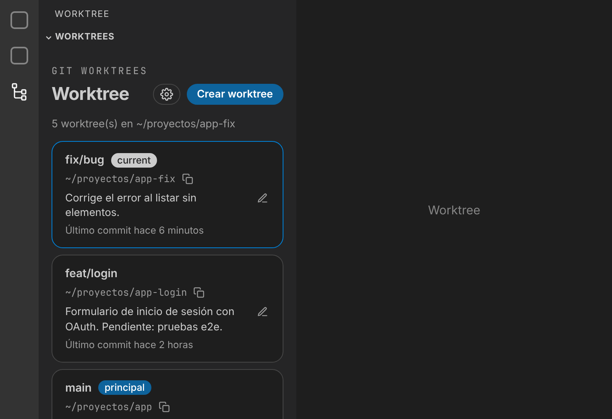
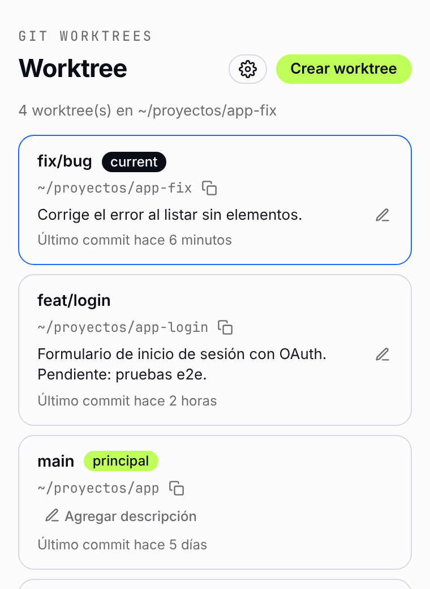
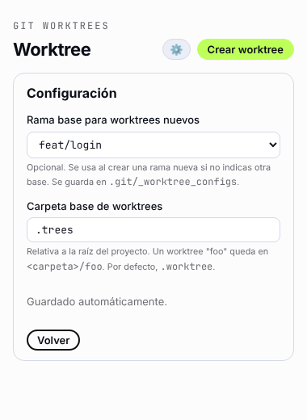
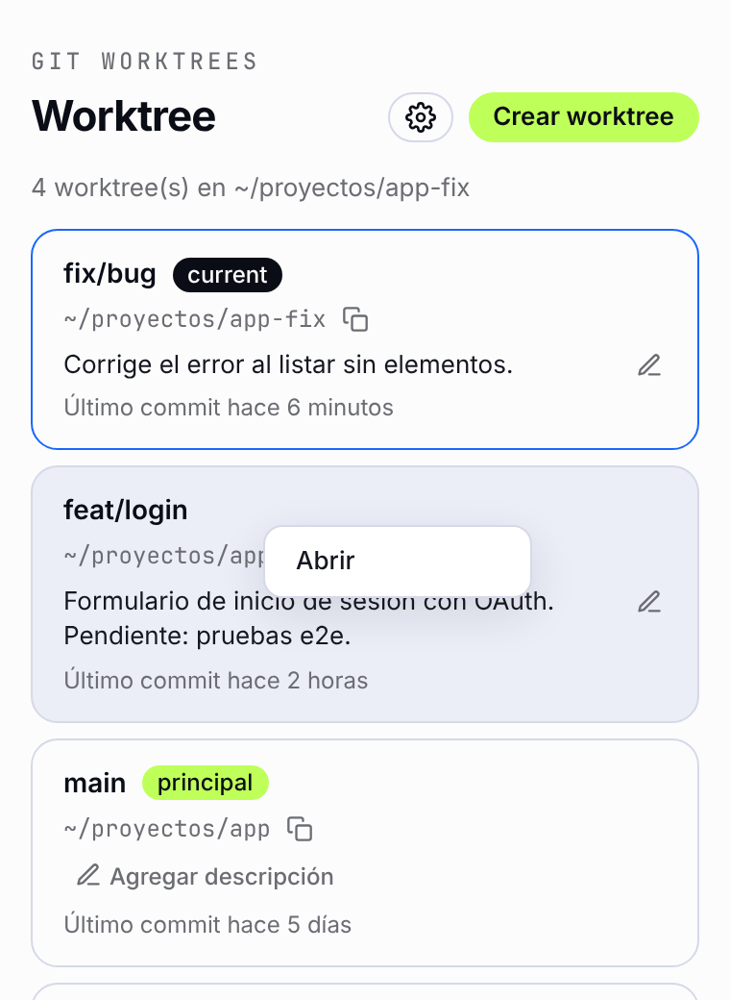
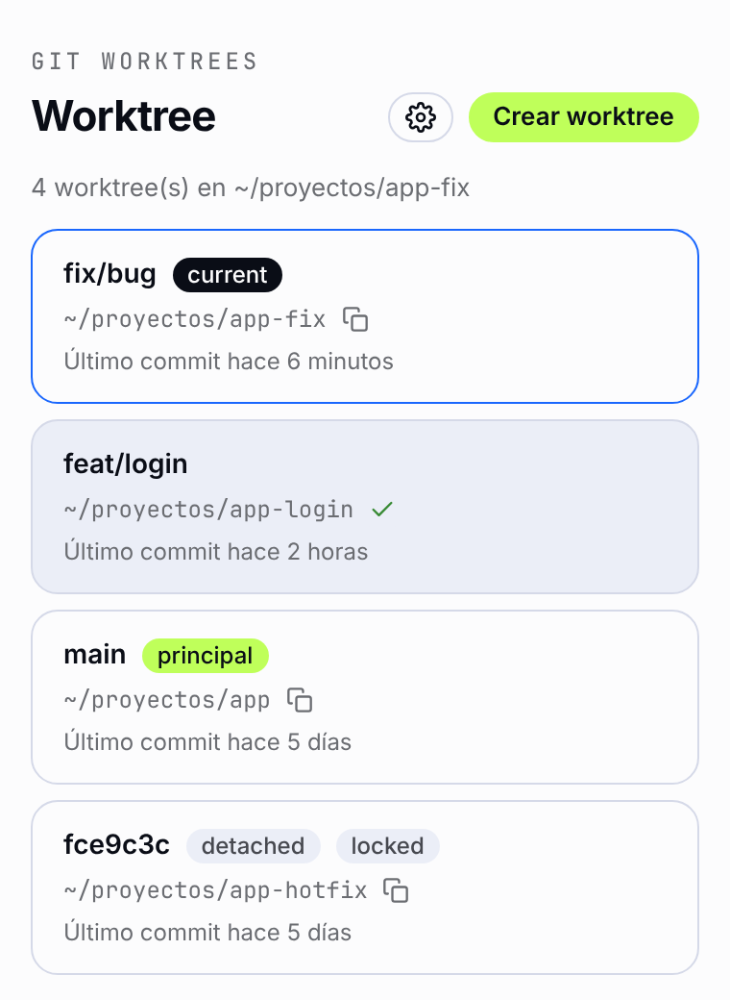
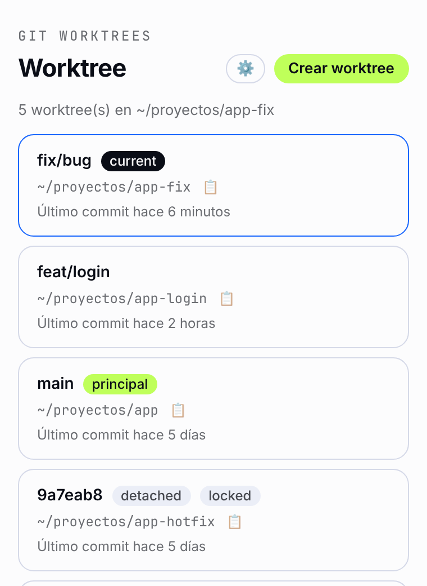
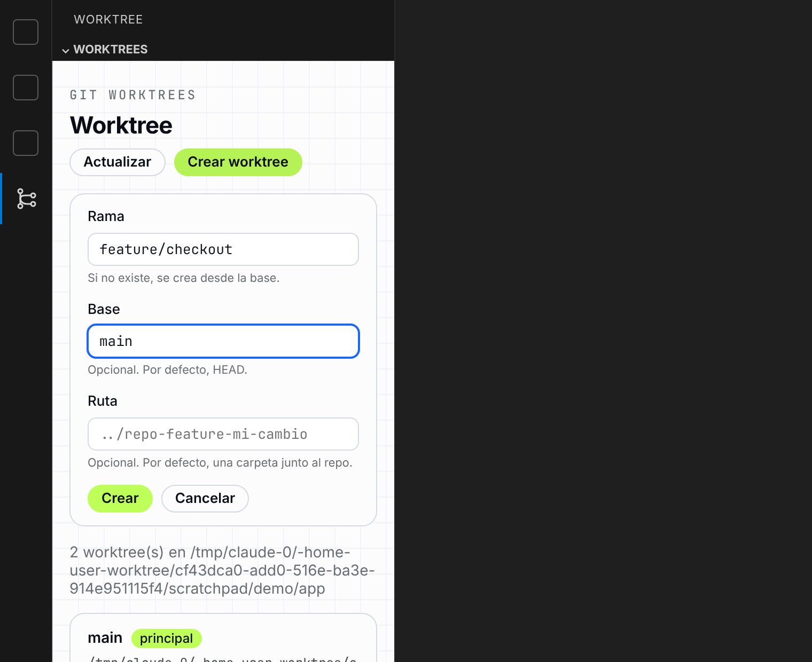
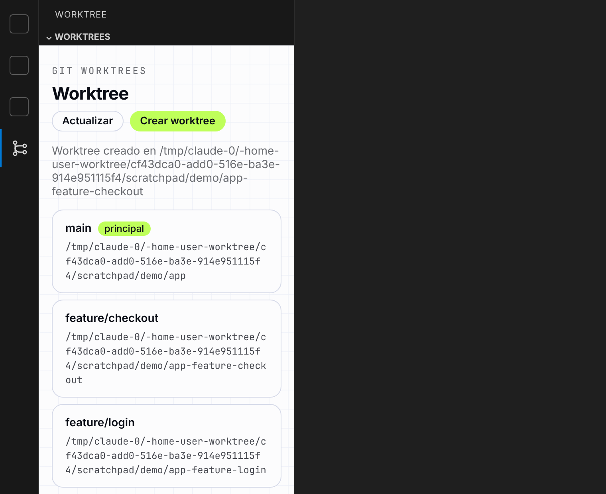

# Worktree

Extensión de Visual Studio Code para visualizar y gestionar los
[git worktrees](https://git-scm.com/docs/git-worktree) de un repositorio sin salir del editor.



## Resumen

Worktree agrega un icono a la barra de actividades de VS Code con una vista que lista todos
los worktrees del repositorio abierto:

- **Ordenados por actividad:** del commit más reciente al más antiguo, con la rama (o el
  commit si está *detached*), la ruta y la fecha del último commit.
- **Worktree actual destacado:** el worktree de la ventana en la que estás se marca con la
  etiqueta `current`; el principal lleva la etiqueta `principal`.
- **Abrir:** doble clic sobre un worktree, o clic secundario → **Abrir**, lo abre en una
  ventana nueva de VS Code.
- **Copiar ruta:** copia la ruta del worktree al portapapeles. Las rutas dentro de tu home se
  muestran abreviadas con `~`.
- **Crear worktree:** formulario con rama, base y ruta opcionales.
- **Actualización en vivo:** la lista se mantiene al día mediante SSE (Server-Sent Events);
  cuando cambian los datos de git la vista se refresca sola.
- **Configuración:** rama base para los worktrees nuevos y carpeta base donde se crean
  (por defecto `.worktree/`, relativa a la raíz del proyecto).

## Capturas

<table width="100%">
  <tr>
    <td align="center" valign="top"><br><sub>Extensión en VS Code</sub></td>
    <td align="center" valign="top"><br><sub>Worktree current</sub></td>
    <td align="center" valign="top"><br><sub>Configuración</sub></td>
    <td align="center" valign="top"><br><sub>Menú Abrir</sub></td>
  </tr>
  <tr>
    <td align="center" valign="top"><br><sub>Copiar ruta</sub></td>
    <td align="center" valign="top"><br><sub>Estados y rutas con ~</sub></td>
    <td align="center" valign="top"><br><sub>Crear worktree</sub></td>
    <td align="center" valign="top"><br><sub>Worktree creado</sub></td>
  </tr>
</table>

La configuración se guarda automáticamente en `.git/_worktree_configs`.

## Instalación

1. Descarga el archivo `.vsix` de la última versión en
   [Releases](https://github.com/JonDotsoy/worktree/releases).
2. Instálalo en VS Code, con *Extensions → ⋯ → Install from VSIX…* o desde la terminal:

   ```sh
   code --install-extension worktree-<versión>.vsix
   ```

3. Abre un repositorio git y pulsa el icono de **Worktree** en la barra de actividades.

## Seguridad

Qué archivos crea, qué comandos ejecuta y cómo reportar una vulnerabilidad: [SECURITY.md](SECURITY.md).

## Desarrollo

Requisitos: [Bun](https://bun.sh) y el comando `code` disponible en el `PATH`
(en VS Code: *Shell Command: Install 'code' command in PATH*).

```sh
bun install
bun ext:dev
```

`bun ext:dev` compila la extensión en `dist/` y abre una nueva ventana de VS Code
con la extensión cargada en modo desarrollo (`--extensionDevelopmentPath`). Verás el
icono de **Worktree** en la barra de actividades.

Al abrir la vista, la extensión levanta un servidor HTTP local (`127.0.0.1`, puerto
aleatorio) que sirve los archivos de `web/`, y los muestra en un webview dentro de la
barra lateral. La web consulta `GET /api/worktrees`, que ejecuta
`git worktree list --porcelain` en la primera carpeta abierta del workspace, y muestra
cada worktree con su rama (o commit si está *detached*), su ruta y la fecha de su último
commit, ordenados del commit más reciente al más antiguo.

Doble clic sobre un worktree (o el menú del clic secundario → **Abrir**) ejecuta
`code <path>`. Si el comando `code` no está en el `PATH`, se abre igual en una ventana
nueva de VS Code.

El botón **Crear worktree** abre un formulario (rama, base y ruta opcionales) que llama a
`POST /api/worktrees`. Si la rama no existe se crea con `git worktree add -b`; la ruta
por defecto es una carpeta hermana del repo (`<repo>-<rama>`). El servidor
cierra al desactivar la extensión.

Otros scripts:

- `bun run build`: compila `src/extension.ts` a `dist/extension.js`.
- `bun run watch`: recompila al guardar.
- `bun run typecheck`: revisa los tipos con TypeScript.
- `bun test`: ejecuta los tests.
- `bun run screenshots`: regenera las capturas de `docs/screenshots/` (crea un repo demo
  temporal, levanta la UI real y la captura con Playwright; define
  `PLAYWRIGHT_CHROMIUM_PATH` para usar otro Chromium).

También puedes usar <kbd>F5</kbd> dentro de VS Code (configuración *Run Extension*).

## Release

El workflow **Release** (`.github/workflows/release.yml`) se ejecuta a mano desde
*Actions → Release → Run workflow*. Elige `patch` (por defecto), `minor` o `major`, y el
workflow:

1. Revisa tipos y corre los tests.
2. Sube la versión en `package.json`.
3. Empaqueta la extensión con `vsce` (`worktree-<versión>.vsix`).
4. Hace commit de la versión (`chore(release): v<versión>`), crea el tag `v<versión>` y los sube a la rama elegida.
5. Crea el release en GitHub con el `.vsix` adjunto.

Para empaquetar localmente: `bun run package`.
