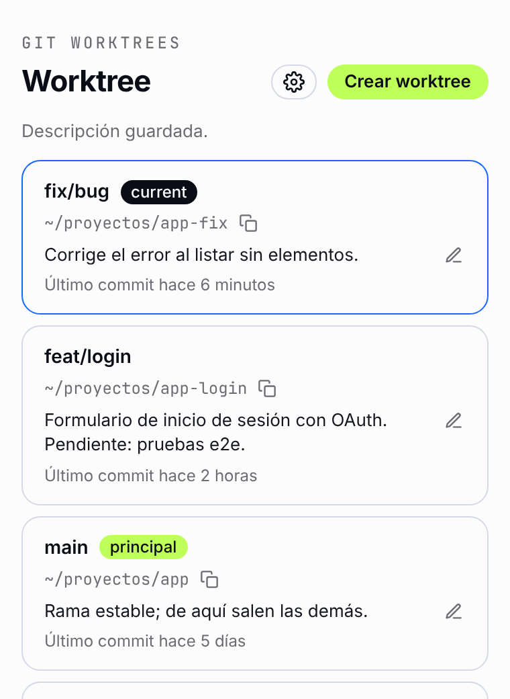
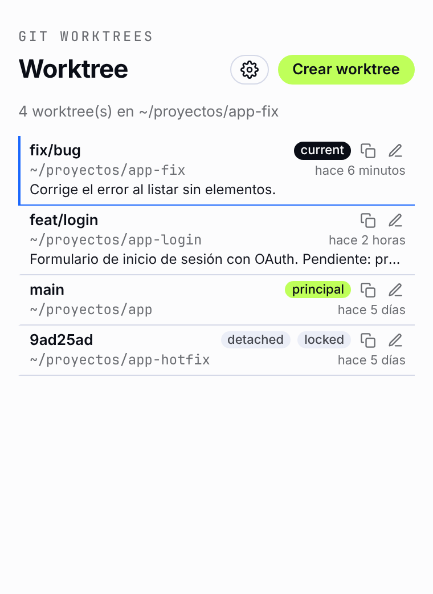

# Worktree

Extensión de Visual Studio Code para visualizar y gestionar los
[git worktrees](https://git-scm.com/docs/git-worktree) de un repositorio sin salir del editor.


## Resumen

Worktree agrega un icono a la barra de actividades de VS Code con una vista que lista todos
los worktrees del repositorio abierto:

- **Ordenados por actividad:** del commit más reciente al más antiguo, con la rama (o el
  commit si está *detached*), la ruta y la fecha del último commit. Al pasar el cursor sobre la fecha relativa se muestra la fecha y hora completas.
- **Worktree actual destacado:** el worktree de la ventana en la que estás se marca con la
  etiqueta `current`; el principal lleva la etiqueta `principal`.
- **Abrir:** doble clic sobre un worktree, o clic secundario → **Abrir**, lo abre en una
  ventana nueva de VS Code.
- **Copiar ruta:** copia la ruta del worktree al portapapeles. Las rutas dentro de tu home se
  muestran abreviadas con `~`.
- **Descripción:** cada tarjeta permite agregar o editar una nota de texto libre (hasta 500
  caracteres). Para editarla, usa el botón de editar o haz doble clic sobre el texto (sin abrir el worktree). Se guarda sola al salir del campo (o con <kbd>Alt</kbd>+<kbd>Enter</kbd>, <kbd>⌘</kbd>+<kbd>Enter</kbd> en Mac) y la comparten todas las ventanas del repositorio.
- **Estrella:** marca un worktree con la estrella (tarjeta y estilo compacto) para fijarlo arriba, justo después del actual. Se guarda en `.git/_worktree_configs/starred.json` y la comparten todas las ventanas.
- **Crear worktree:** formulario con rama, base y ruta opcionales.
- **Actualización en vivo:** la lista se mantiene al día mediante SSE (Server-Sent Events);
  cuando cambian los datos de git la vista se refresca sola.
- **Configuración:** rama base para los worktrees nuevos, carpeta base donde se crean
  (por defecto `.worktree/`, relativa a la raíz del proyecto) y **estilo compacto**.
- **Estilo compacto:** desde la configuración (⚙️) la lista pasa de tarjetas a filas densas:
  rama, `current`/`principal`, ruta con `~`, tiempo relativo (al pasar el cursor, la fecha
  completa), descripción resumida en una línea y las acciones de copiar y editar la descripción.
  Doble clic, <kbd>Enter</kbd> y el menú **Abrir** funcionan igual. Se guarda sola y se
  refleja en las demás ventanas del repositorio.

## Capturas

<table width="100%">
  <tr>
    <td align="center" valign="top"><br><sub>Extensión en VS Code</sub></td>
    <td align="center" valign="top"><br><sub>Worktree current</sub></td>
    <td align="center" valign="top"><br><sub>Configuración</sub></td>
    <td align="center" valign="top"><br><sub>Menú Abrir</sub></td>
  </tr>
  <tr>
    <td align="center" valign="top"><br><sub>Copiar ruta</sub></td>
    <td align="center" valign="top"><br><sub>Estados y rutas con ~</sub></td>
    <td align="center" valign="top"><br><sub>Descripción por worktree</sub></td>
    <td align="center" valign="top"><br><sub>Estilo compacto</sub></td>
    <td align="center" valign="top"><br><sub>Crear worktree</sub></td>
    <td align="center" valign="top"><br><sub>Worktree creado</sub></td>
  </tr>
</table>

La configuración y las descripciones se guardan automáticamente en `.git/_worktree_configs`.

## Instalación

1. Descarga el archivo `.vsix` de la última versión en
   [Releases](https://github.com/JonDotsoy/worktree/releases).
2. Instálalo en VS Code, con *Extensions → ⋯ → Install from VSIX…* o desde la terminal:

   ```sh
   code --install-extension worktree-<versión>.vsix
   ```

3. Abre un repositorio git y pulsa el icono de **Worktree** en la barra de actividades.

## Seguridad

Qué archivos crea, qué comandos ejecuta y cómo reportar una vulnerabilidad: [SECURITY.md](SECURITY.md).

## Contribuir

Cómo ejecutar la extensión en desarrollo y publicar una versión: [CONTRIBUTING.md](CONTRIBUTING.md).

## Licencia

[MIT](LICENSE) © 2026 [Jonathan Delgado](https://jon.soy)
